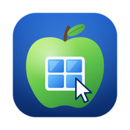

<p align="center"></p>

# OpenRDP

[](https://github.com/org-event/OpenRDP/actions/workflows/ci.yml)
[](#license)

[Русская версия](README.ru.md)

An open RDP server for macOS, built on [IronRDP](https://github.com/Devolutions/IronRDP). Linux is planned. It lets you work on a remote Mac all day from any RDP client with GFX/H.264 support: Windows App (macOS, Windows, iOS), FreeRDP or Remmina (Linux).

> **Status: early, but usable.** The author uses it daily on a Mac mini (M2 Pro, macOS 27) from a MacBook over WireGuard. Expect rough edges; see [open questions](#open-questions). Apple Silicon only for now.

> The project was called macRDP, and the binary, app and agent still are: `macrdp`, `macRDP.app`, `com.macrdp.server`. They will be renamed in a later release; renaming them makes macOS ask for the permissions again.

## How it works

- **Capture**: ScreenCaptureKit, straight to NV12 full-range BT.709 (the AVC color space of MS-RDPEGFX), with no conversion.
- **Encoding**: VideoToolbox H.264, realtime, low latency, no B-frames.
- **Graphics**: the EGFX channel, AVC420. The surface is aligned to 16 and the extra pixels are cut off by a region.
- **Screen size**: a virtual display (`CGVirtualDisplay`) matches the client's window, in HiDPI, capped at 3072×1920 by area (`--max-size`). It survives a disconnect for 5 minutes, so windows stay put when you reconnect.
- **Input**: `CGEventPost`. RDP scancodes are mapped to Mac keycodes: Win → Command, Alt → Option. Double clicks are counted.
- **Cursor**: sent as RDP pointer updates and drawn by the client, so it moves without video latency.
- **Clipboard**: text and images, both ways.
- **Power**: the Mac stays awake while the server runs, and its display stays on while a client is connected. A connecting client wakes a sleeping display.

## Requirements

- A Mac with Apple Silicon (M1 or newer). Tested on macOS 27.
- Rust stable (`rustup`). The toolchain is pinned in `rust-toolchain.toml`.
- Screen Recording and Accessibility permissions, granted at the Mac itself (see below).

## Build and run

```bash
cargo build --release
./target/release/macrdp --user me --pass secret
```

The server listens on `0.0.0.0:3389` and authenticates with NLA. The user name and password are the server's own; they are not your macOS account. The password can also come from `MACRDP_PASSWORD`. The TLS certificate is self-signed (RSA, because Windows App rejects ECDSA) and is created on first run in `~/Library/Application Support/macrdp`. Run `macrdp --help` for all options.

macOS grants Screen Recording and Accessibility to the app that started the server (Terminal, Ghostty and so on), and the server has to be restarted after granting them. The server asks for both on startup, so macOS adds that app to the lists:

- **Screen & System Audio Recording**: no picture without it;
- **Accessibility**: no keyboard or mouse without it.

To check the video path without any permissions, use `--test-pattern`. It sends a synthetic picture instead of the screen.

Check with FreeRDP:

```bash
sdl-freerdp /v:127.0.0.1 /u:me /p:secret /cert:ignore /gfx:avc420
```

In Windows App on a Mac, set the Command key to be sent as Windows: the host then sees it as Command.

## Start at login

```bash
./target/release/macrdp install --user me --pass secret
```

This copies the server into `~/Applications/macRDP.app` and installs the LaunchAgent `com.macrdp.server`. The server starts when you log in and restarts if it crashes. The password is stored in `~/Library/LaunchAgents/com.macrdp.server.plist` with mode 600, and the log goes to `~/Library/Logs/macrdp.log`. In this mode the permissions are granted to "macRDP" rather than to a terminal. They can only be granted at the Mac; restart the server afterwards:

```bash
launchctl kickstart -k gui/$(id -u)/com.macrdp.server
```

After updating the build, run `install` again. It signs the app with a local certificate from a separate keychain in `~/Library/Application Support/macrdp`, so macOS recognises the new build as the same app and keeps the permissions. `macrdp uninstall` removes both the agent and the app.

**The server does not run at the login window.** It starts only after you log in. After a reboot with FileVault on, unlocking the disk over SSH does not log you in: connect with Screen Sharing (VNC) and log in there, for example through an SSH tunnel, `ssh -N -L 5901:127.0.0.1:5900 you@mac` and then `vnc://127.0.0.1:5901`. Another option is `sudo fdesetup authrestart` before the reboot.

## Health check and wake: `macrdp-doctor`

[`scripts/macrdp-doctor`](scripts/macrdp-doctor) checks everything remote access depends on and can fix the common cases. It is meant to be run over SSH on the host:

```bash
scripts/macrdp-doctor           # check: session, agent, port, permissions, signing, power, network
scripts/macrdp-doctor wake      # wake the display
scripts/macrdp-doctor restart   # restart the agent
scripts/macrdp-doctor vpn       # bring up the WireGuard tunnel (needs a logged-in session)
```

On another machine, `macrdp-doctor wol <MAC> [broadcast]` sends a Wake-on-LAN packet to a Mac that is asleep (it needs Wake for network access on the host, `pmset womp 1`).

## Open questions

The roadmap and design notes are in [docs/plan.md](docs/plan.md) (in Russian). Main gaps:

- the login window: a LaunchDaemon that serves before anyone logs in;
- AVC444 for sharper text;
- adaptive bitrate and frame rate;
- sound, drive redirection, file copy through the clipboard;
- curtain mode (the host's own screen goes dark);
- Intel Macs.

## Contributing

Contributions are welcome. See [CONTRIBUTING.md](CONTRIBUTING.md). Report security issues privately as described in [SECURITY.md](SECURITY.md).

## License

Licensed under either of

- Apache License, Version 2.0 ([LICENSE-APACHE](LICENSE-APACHE))
- MIT license ([LICENSE-MIT](LICENSE-MIT))

at your option.

Unless you explicitly state otherwise, any contribution intentionally submitted for inclusion in the work by you, as defined in the Apache-2.0 license, shall be dual licensed as above, without any additional terms or conditions.
